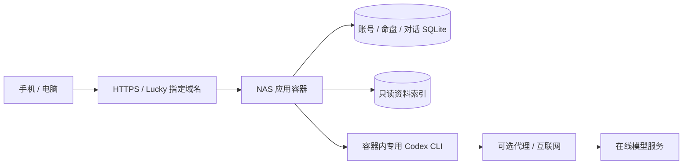

# Mingli 跨电脑交接

更新：2026-11-01，Asia/Shanghai。本次按维护者要求先保存并推送当前实现，已确认的问题留给下一台电脑上的 Codex 修复。**这是带已知问题的开发基线，不能据此认定全部验收通过。**

仓库：[Linjay/ziwei-doushu](https://github.com/Linjay/ziwei-doushu)，从 [Renhuai123/ziwei-doushu](https://github.com/Renhuai123/ziwei-doushu) Fork，保留上游历史及许可。当前分支 `main`，推送到自己的 `origin`；`upstream` 只用于对照原项目。用 `git rev-parse HEAD` 记录接手提交，不使用本地发布目录里的独立快照提交替代主仓库历史。

## 接手顺序

1. 阅读本文及 [待修复问题](docs/KNOWN_ISSUES.md)，先处理跨标签页账号切换串写历史，再处理改密后的设备凭据轮换，最后修复首页浏览器测试的系统动态偏好依赖。
2. 在新电脑克隆、安装依赖、运行下面的检查和隔离复现。默认使用新建本地数据库，不连接 NAS 用户库。
3. 修复后补回归，检查单盘、合盘、专业 / 通俗与多主题的保存、恢复、导入导出，再提交修复。
4. NAS 部署是后续独立操作。本次只提交 GitHub，不更新 NAS、Lucky、认证或数据库。生产更新前按 [部署说明](docs/NAS部署.md)备份并验收。

## 已实现及代码入口

| 能力 | 当前实现 | 主要入口 |
| --- | --- | --- |
| 排盘 | 单盘 / 合盘、公历 / 农历与闰月、真太阳时及跨日校正、原始出生资料留存 | `components/BirthForm.tsx`、`lib/birth-input.ts`、`lib/ziwei/` |
| AI 解读 | 部署环境的 Codex CLI、SSE 流式、追问 / 停止 / 超时、资料出处 | `lib/server/codex-cli.ts`、`codex-protocol.ts`、`interpretation.ts`、`lib/ai-stream.ts` |
| 阅读模式 | 六个独立主题、专业 / 通俗分别保存、双排图标导航、保存命盘 SVG 图解；合盘展示双方 | `components/InsightPanel.tsx`、`ComparisonWorkspace.tsx`、`ReadingGuide.tsx`、`lib/reading-modes.ts` |
| 账号 | 注册登录、快速体验账号、设备记忆 / 账号选择、个人档案、改密 / 退出 / 忘记设备 | `components/AccountProvider.tsx`、`app/api/auth/`、`lib/server/device-auth.ts` |
| 历史 | 账号 SQLite、单盘与合盘跨设备恢复、搜索 / 重命名 / 删除、JSON v1–v4 导入、v4 导出 | `lib/chart-history.ts`、`history-backup.ts`、`use-chart-history.ts`、`lib/server/account-history.ts` |
| 检索 | v3 / v4 同盘匹配、古籍及《天纪》关键词检索、有界节选与原文页、授权模式过滤 | `scripts/build-knowledge.mjs`、`lib/server/knowledge.ts`、`app/sources/` |
| 首页 / 移动端 | 首页动画与减少动态效果、资料规模、登录后优先恢复旧盘、底部五导航、两步表单、长文及键盘输入 | `app/home.css`、`app/mobile.css`、`components/home/`、`lib/use-reading-scroll.ts` |
| 部署 | Node.js 24、独立非 root 容器、持久账号库 / CLI 认证、只读资料索引、Lucky 转发 | `Dockerfile`、`compose.yaml`、`deploy/` |

账号功能已有两个已复现的边界缺陷，详见问题文档，不能把“已实现”理解成隔离与撤销已完成全部验收。

## 在另一台电脑启动

使用 Node.js 24（含 `node:sqlite` 和 zstd 支持）、npm 和 Git。Windows 如需安装软件，按维护者要求优先 `D:\Promgram Files`。无需下载约 18 GB 资料即可开发和运行假 CLI 测试。

```powershell
git clone https://github.com/Linjay/ziwei-doushu.git mingli
Set-Location mingli
git remote add upstream https://github.com/Renhuai123/ziwei-doushu.git
git config remote.pushDefault origin
git switch -c codex/fix-account-isolation
npm ci
Copy-Item .env.example .env.local
npm run dev -- --hostname 127.0.0.1 --port 3100
```

默认本地库在被忽略的 `.codex-local/app-data/`，与 NAS 独立。先检查 3100 端口占用，不结束其他进程。真实 AI 需要在该开发环境单独安装并登录 Codex CLI，或配置 `CODEX_CLI_PATH`；认证文件不在仓库。网页真实解读会使用该 CLI 账号的在线额度。下面测试与复现脚本自带假 CLI，不要求真实登录。

读取根目录 `AGENTS.md`；修改 Next.js 代码前，按其要求查阅已安装的 `node_modules/next/dist/docs/` 对应指南。

## 验证命令与当前结果

```powershell
npm run typecheck
npm run test:navigation
npm run test:birth
npm run test:history
npm run test:accounts
npm run test:ai
npm run test:knowledge
npm run test:reading-visuals
npm test
$env:NEXT_TELEMETRY_DISABLED='1'
npm run build
npm run test:browser
```

本次 review 已执行：类型检查、生产构建、121 项专项（历史 33 / 账号 32 / AI 24 / 检索 13 / 日期 14 / 导航 2 / 图示 3）及原引擎回归通过，后者包含 768 盘与 24,106 天差分。浏览器整套在本机 **未通过**：移动端 14 条、快速账号 7 条通过后，首页动画测试受系统 `prefers-reduced-motion: reduce` 影响失败，后续链式步骤未执行。单独执行双模式 / 图示浏览器测试 11 条通过；仅在本地临时副本中明确模拟 `no-preference` 后，首页 9 条通过，这不是已提交测试全部通过的证据。

这些通过的测试未覆盖跨标签页串写和设备旧凭据问题。必须补针对性回归，不能只重跑原测试便宣告修复完成。详见 [复现脚本和验收条件](docs/KNOWN_ISSUES.md)。交接整理后再次执行类型检查、生产构建与 Compose 配置校验通过；两份入库复现脚本均实际执行，仍确认上述账号缺陷。没有为提交而跳过或改写失败的首页测试。

```powershell
# 先 npm run build，再执行。需本机 Chrome；非默认安装位置设置 CHROME_PATH。
npm run repro:cross-tab
npm run repro:device-token
```

脚本只创建本地临时账号、独立 SQLite 与假 CLI，不访问 NAS、不打印认证令牌。报告及截图写入 `.codex-local/`。`reproduced:true` / `oldCredentialStillAuthenticates:true` 代表缺陷复现，**不是产品验收通过**。macOS 或非默认 Chrome 路径须设置 `CHROME_PATH`；默认支持 Windows Chrome 和 Linux `/usr/bin/google-chrome`。

## 数据、备份与格式约定

- 大数据与运行数据不在 Git：`data/`、`knowledge/`、`codex/`、`runtime.env`、`.env.local`、SQLite、`.codex-local/` 均被忽略。旧截图与逐次运维证据保留在本机 `docs/releases/`、`docs/reviews/`，也排除提交；上游已跟踪的文档和图片保留。新电脑通过本文与脚本接手，不依赖本机证据文件。
- 迁移资料记录为 940 个原始文件、约 17.96 GB；索引约 11.05 GB。有效样本 v3 515,880 + v4 674,976 = 1,190,856，版本之间有重合，不是独立命盘数。另有 1,923 段文献（75 古籍整理 + 1,848《天纪》引文）和 16 个讲次 Markdown。布局、重建和授权见 [资料检索](docs/资料检索.md)。统计对应既有 NAS 资料快照，克隆不会自动取得这些运行资产。
- v3 覆盖 1924–1983 且不含 31 日，2,520 个无效日期已从索引排除；v4 覆盖 1950–2026。检索按校正后的日期 / 时辰 / 性别匹配，无同盘不借用其他生日。
- 代码 MIT、公开数据 CC BY 4.0、《天纪》引文 CC BY-NC-SA 4.0 分开处理。`personal` 为个人非商业模式，`commercial` 排除《天纪》和混合授权 v3 / v4 正文，仅保留古籍整理。没有取得上游私有商业断语库、Prompt、会员或支付系统；167 个待授权来源也不等同已下载且可用的全文。
- 备份 v1 为旧单盘；v2 含合盘；v3 含独立主题；v4 含专业 / 通俗。账号历史内部 envelope `version:1` 与 JSON 备份版本无关。不得降低版本或只保留当前可见主题。
- `kind:comparison` 必须保留 `chartB`；`insight.topics`、`plainTopics`、`readingMode` 和各主题 / 模式更新时间参与恢复与合并。删除 tombstone 防止旧缓存复活，主动导入允许恢复删除项，冲突保留副本，重复导入去重。
- 新出生资料的 `origInput.conversionVersion:1` 保留原始公历 / 农历、闰月、北京时间和未知时刻；根日期已经校正。服务器核验后重建，不二次换日，不自动覆盖旧盘。
- 草稿与滚动位置仅保存在当前浏览器会话，不进入 JSON 或跨设备同步。显示“已同步到账户”才代表保存完成；不能承诺任意断网 / 立即关页都已上传。
- 快速账号初始密码 `12345678` 是维护者指定的体验策略，不是误提交的真实密码。普通注册 / 新密码为 10–128 字符；设备是浏览器 Cookie，不是硬件指纹。改密应撤销旧凭据，但当前实现的轮换缺陷待修。

## 运行架构与部署边界



Windows 开发电脑不在 NAS 运行链路中。站内用户共用服务端 CLI 账号额度；业务记录按站内账号存储，账号边界缺陷须优先修复。

上次记录的 NAS 版本为 `mingli:20261101-readingui`。本轮未重新探测或部署，GitHub 提交与线上镜像不是同一个发布标识。公网入口、NAS 地址 / SSH、实际目录、代理凭据和回滚位置在维护者私有 Homelab 项目的 `docs/services/mingli.md`、`docs/runbooks/mingli-deploy.md` 与 inventory；凭据从私有配置取得，不复制到公开文档。本机原交接的完整副本保留在 `.codex-local/commit-handoff-*/worktree/`，最新位置由 `.codex-local/commit-handoff-latest.json` 指向。

公开 `compose.yaml` 改用通用参数，`deploy/runtime.env.example` 提供占位配置。**切勿直接把默认模板覆盖到既有 NAS**：保留真实监听地址、端口、允许来源、模型、代理及知识库配置。只修改该服务和 Lucky 对应子规则，不覆盖其他站点。

## 后续顺序与移动端验收

1. 完成 [三项修复及回归](docs/KNOWN_ISSUES.md)，优先保证账号数据隔离。
2. 产品缺口：百科仍为空占位；所选运限 / 年份未完整传给 AI；海外时区、夏令时与流派入口未形成完整表单闭环；13 维资料有覆盖但 UI 只有六主题。不得称为商用完整版。
3. 移动端按常见 App 验收：首页 / 命盘 / 合盘 / 历史 / 我的五导航，选中态清楚；主题和阅读模式独立；点击目标至少 48px、输入文字至少 16px；安全区、键盘与底部输入区无重叠。
4. 覆盖 320 / 360 / 390 / 430px 和 768 / 1024px；在 iOS Safari、Android Chrome、微信浏览器真机检查返回 / 刷新恢复、键盘发送、长文滚动 / 回到底部、横竖屏、后台恢复、弱网断流 / 重试、减少动态效果和读屏。已有用户只反馈过某台手机输入发送正常，不能替代多平台验收。
5. 修复通过后再执行明确授权的 NAS 更新：备份、构建、定向转发检查、隔离账号验收、原有账号 / 历史数量和内容完整性核对、回滚验证，然后更新交接。不得用生产私密命盘做自动测试夹具。
